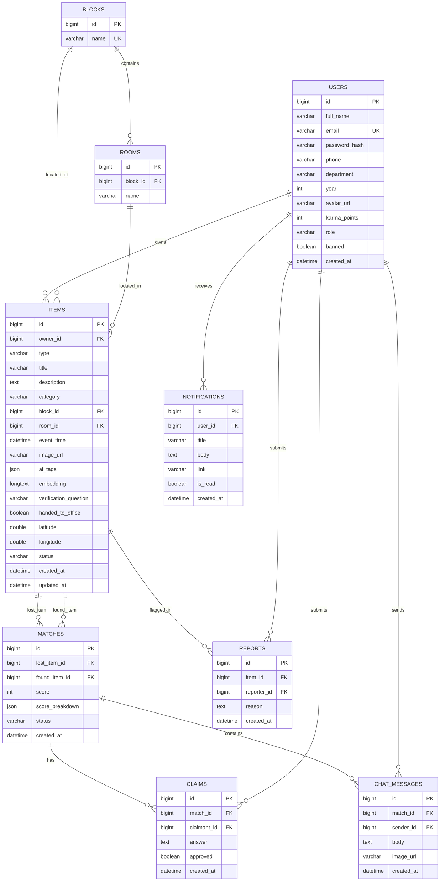
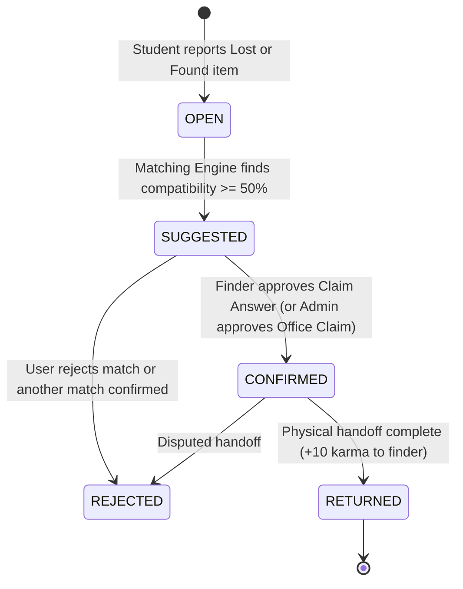

# CampusFind 🎒🔍

> A modern, privacy-first college lost and found platform that matches lost items using location, category, timestamps, and AI photo analysis, enabling secure in-app connections between finder and owner.

---

## 🎯 The Problem

On college campuses, hundreds of items are misplaced every week (watches, ID cards, water bottles, earphones, notebooks). Currently:
- Students post on messy WhatsApp or Telegram groups where sensitive personal contact numbers are exposed to thousands of strangers.
- Posts get buried in minutes.
- Fraudulent claims happen frequently because there is no verification mechanism.
- Items handed to department offices or security lack central visibility.

**CampusFind** solves this with an automated matching engine and privacy-by-design architecture:
1. Students report lost or found items with location tags (campus block + classroom/hall), timestamps, categories, and photos.
2. The matching algorithm computes a compatibility score out of 100.
3. Once matched, the app creates a **private, secure in-app chat** between only the two matched students—no phone numbers or private emails revealed.
4. The finder can pose a secret claim verification question (e.g. *"What is the laptop wallpaper?"*) before handing over the item.

---

## 🌟 Full Feature List (6-Step Roadmap)

- 🔒 **College Email Only Authentication:** Institutional JWT signup/login with `@college.edu` verification and role-based permissions (`ROLE_STUDENT`, `ROLE_ADMIN`).
- 📌 **Detailed Lost/Found Postings:** High-resolution photos, block, room number, timestamp, category, and condition.
- ⚡ **Smart Matching Engine (100 Points):** Evaluates spatial proximity (block + room), category, temporal overlap, and image embedding similarity.
- 💬 **Private Real-time STOMP Chat:** Secure WebSocket messaging isolated strictly to matched student pairs.
- 🔑 **Claim Verification Handoff:** Finder challenge questions to confirm true ownership prior to physical handover.
- 🔄 **Lifecycle State Machine:** `OPEN` ➔ `MATCHED` ➔ `RETURNED` ➔ `CLOSED`.
- 🔔 **Multi-channel Notifications:** In-app real-time alerts and transactional emails via Spring Mail.
- 🤖 **AI Superpowers with Google Gemini:** Automatic tagging and description auto-fill from photos, visual similarity scoring, and sensitive content detection (faces, government ID numbers).
- 🗺️ **Campus Map & Safe Drop Points:** Visual campus pin locator with designated drop points (Library front desk, Campus Security).
- 🏆 **Karma, Badges & Leaderboard:** Incentivizing student honesty with karma points and community recognition.
- 🛡️ **Admin Governance Dashboard:** Audit logs, report resolutions, post moderation, user bans, and analytics.
- 📱 **Modern Mobile-First PWA:** Responsive React interface with dark mode and installable Progressive Web App support.

---

## 🛠️ Tech Stack

### Backend
- **Language / Runtime:** Java 21
- **Framework:** Spring Boot 3.3.4 (Maven)
- **Security:** Spring Security 6 with JWT (HMAC-SHA256)
- **Database:** MySQL 8 with Hibernate / Spring Data JPA
- **Database Migrations:** Flyway (`flyway-mysql`)
- **Real-Time:** Spring WebSocket with STOMP & SockJS
- **Communication:** Spring Mail (SMTP)
- **AI Integration:** Google Gemini API
- **Media Hosting:** Cloudinary

### Frontend
- **Framework:** React 18 + Vite
- **Language:** TypeScript
- **Styling:** Tailwind CSS + PostCSS + Lucide Icons
- **HTTP Client:** Axios

### Infrastructure & DevOps
- **Containerization:** Docker & Docker Compose
- **Configuration:** Multi-profile `application.yml` (`dev`, `prod`) with environment variable isolation

---

## 📁 Repository Structure

```text
campusfind/
├── .env.example              # Template for environment variables and secrets
├── .gitignore                # Git exclusions (build artifacts, secrets, logs)
├── docker-compose.yml        # Local MySQL 8 database service with healthcheck
├── README.md                 # Project documentation and setup instructions
│
├── backend/                  # Spring Boot 3 + Java 21 Backend
│   ├── pom.xml               # Maven configuration
│   └── src/
│       ├── main/
│       │   ├── java/com/campusfind/
│       │   │   ├── CampusFindApplication.java
│       │   │   ├── config/      # CORS and MVC configuration
│       │   │   ├── controller/  # REST API endpoints & Health check
│       │   │   ├── dto/         # Request & Response objects (ApiResponse)
│       │   │   ├── entity/      # JPA entities (User, ItemPost, Match, etc.)
│       │   │   ├── exception/   # GlobalExceptionHandler & custom exceptions
│       │   │   ├── repository/  # Spring Data JPA repositories
│       │   │   ├── security/    # Security filter chain & JWT utilities
│       │   │   ├── service/     # Business logic layer
│       │   │   └── util/        # Helper functions & date formatting
│       │   └── resources/
│       │       ├── application.yml   # Multi-profile Spring configuration
│       │       └── db/migration/     # Flyway SQL migrations
│       └── test/                     # Unit and integration test suites
│
└── frontend/                 # React + Vite + TypeScript Frontend
    ├── package.json          # Frontend dependencies and scripts
    ├── tsconfig.json         # TypeScript compiler configuration
    ├── vite.config.ts        # Vite configuration with /api proxy
    ├── tailwind.config.js    # Tailwind styling configuration
    ├── index.html            # Main HTML document
    └── src/
        ├── App.tsx           # Main application view
        ├── main.tsx          # React DOM entry point
        ├── components/       # Shared UI components
        ├── pages/            # Application views and dashboards
        ├── services/         # Axios API clients
        └── types/            # TypeScript interfaces
```

---

## 🗄️ Database Architecture & Entity Relationship Diagram

The database schema is managed via Flyway migrations (`V1__init.sql`, `V2__core_schema.sql`, `V3__seed_data.sql`) with strict Hibernate validation (`ddl-auto=validate`).



---

## 🚀 Getting Started & Local Setup

### 1. Prerequisites
- **Java 21 JDK** installed (`java -version`)
- **Maven 3.9+** or Maven wrapper (`mvn -version`)
- **Node.js 18+ & npm** (`node -v`)
- **Docker & Docker Compose** (`docker --version`)

### 2. Environment Configuration
Copy `.env.example` to `.env`:
```bash
cp .env.example .env
```
Ensure your configuration values match your local database and credentials.

### 3. Start MySQL 8 via Docker Compose
Start the localized MySQL 8 database container:
```bash
docker compose up -d
```
Verify the container status:
```bash
docker compose ps
```
The MySQL container is configured with UTF-8 (`utf8mb4_unicode_ci`), UTC timezone, a persistent named volume `campusfind_mysql_data`, and automatic health checks.

### 4. Build and Run the Backend
Navigate to `/backend`:
```bash
cd backend
mvn clean spring-boot:run
```
The Spring Boot backend will start on **`http://localhost:8081`**.
Verify system health and database connectivity:
```bash
curl http://localhost:8081/api/v1/health
```

Sample standard response:
```json
{
  "success": true,
  "message": "CampusFind service is operational",
  "data": {
    "status": "UP",
    "service": "campusfind-backend",
    "activeProfile": "[dev]",
    "databaseStatus": "CONNECTED (MySQL 8.0.x)",
    "serverTime": "2026-10-11T19:25:00.000000"
  },
  "timestamp": "2026-10-11T19:25:00.000000"
}
```

### 5. Start the Frontend Application
In a separate terminal, navigate to `/frontend`:
```bash
cd frontend
npm install
npm run dev
```
Open your browser at **`http://localhost:5173`**. The Vite server proxies API calls to `http://localhost:8080`.

---

## 🛡️ Standard API Response Format

All API endpoints follow a unified response structure:

```json
{
  "success": true,
  "message": "Operation completed successfully",
  "data": { ... },
  "timestamp": "2026-10-11T19:25:00.000",
  "errors": null
}
```

On validation or business logic exceptions:
```json
{
  "success": false,
  "message": "Validation failed",
  "data": null,
  "timestamp": "2026-10-11T19:25:00.000",
  "errors": {
    "email": "Must be a valid college domain email",
    "category": "Category is mandatory"
  }
}
```

---

## 📡 REST API Reference

### 1. Authentication & User Profile (`/api/v1/auth`, `/api/v1/users`)
| Method | Endpoint | Access | Description |
|---|---|---|---|
| `POST` | `/api/v1/auth/register` | Public | Register student with `@college.edu` domain email |
| `POST` | `/api/v1/auth/login` | Public | Authenticate student/admin and receive 24h JWT token |
| `GET` | `/api/v1/auth/me` | Authenticated | Retrieve current user profile (including private info) |
| `PUT` | `/api/v1/users/me` | Authenticated | Update user profile (`fullName`, `department`, `year`, `avatarUrl`, `phone`) |
| `POST` | `/api/v1/users/me/change-password` | Authenticated | Change user password |

### 2. Reference Data (`/api/v1`)
| Method | Endpoint | Access | Description |
|---|---|---|---|
| `GET` | `/api/v1/blocks` | Public / Cached | Retrieve campus blocks and their associated rooms |
| `GET` | `/api/v1/categories` | Public / Cached | Retrieve item category enums and friendly display names |

### 3. Media Upload (`/api/v1/uploads`)
| Method | Endpoint | Access | Description |
|---|---|---|---|
| `POST` | `/api/v1/uploads/image` | Authenticated | Upload multipart image (max 5MB, JPEG/PNG/WebP magic-byte validation). Cloudinary with local fallback |

### 4. Items Management (`/api/v1/items`)
| Method | Endpoint | Access | Description |
|---|---|---|---|
| `POST` | `/api/v1/items` | Authenticated | Report a Lost or Found item (rate limited: 10 items/24h per user) |
| `GET` | `/api/v1/items` | Authenticated | Paginated item search with filters (`type`, `category`, `blockId`, `roomId`, `status`, `keyword`, `mine=true`) |
| `GET` | `/api/v1/items/{id}` | Authenticated | Get full details of an item (owner masked to `PublicUserDto`) |
| `PUT` | `/api/v1/items/{id}` | Owner / Admin | Update item details (cannot update once `RETURNED`) |
| `DELETE` | `/api/v1/items/{id}` | Owner / Admin | Delete an item |
| `POST` | `/api/v1/items/{id}/report` | Authenticated | Report an item (auto-hidden if reports reach >= 3) |

### 5. Smart Matches & Claims Verification (`/api/v1/matches`)
| Method | Endpoint | Access | Description |
|---|---|---|---|
| `GET` | `/api/v1/matches` | Authenticated | List all matches involving items owned by the current user |
| `GET` | `/api/v1/matches/{id}` | Participant | Retrieve details of a match (both items masked for privacy) |
| `POST` | `/api/v1/matches/{id}/reject` | Participant | Reject a suggested match |
| `GET` | `/api/v1/matches/{id}/verification` | Participant | View finder's verification question (or office pickup instructions) |
| `POST` | `/api/v1/matches/{id}/claim` | Lost Owner | Submit answer to verification question (max 3 attempts, returns 429 on 4th) |
| `GET` | `/api/v1/matches/{id}/claims` | Participant | View submitted claim answers |
| `POST` | `/api/v1/matches/{id}/claims/{claimId}/approve` | Finder Only | Approve claim: Match becomes `CONFIRMED`, items `MATCHED`, competing matches `REJECTED`, chat unlocks |
| `POST` | `/api/v1/matches/{id}/claims/{claimId}/reject` | Finder Only | Reject claim answer |
| `POST` | `/api/v1/matches/{id}/claim-office` | Lost Owner | Submit office pickup proof when item has `handedToOffice = true` |
| `POST` | `/api/v1/matches/{id}/returned` | Participant | Mark item returned: Sets status `RETURNED`, awards finder +10 karma points, chat becomes read-only |

### 6. Realtime & REST Chat (`/api/v1/matches/{id}/messages`)
| Method | Endpoint | Access | Description |
|---|---|---|---|
| `POST` | `/api/v1/matches/{id}/messages` | Participant | Send message in match chat (HTTP fallback, max 1000 chars, max 30 msgs/min) |
| `GET` | `/api/v1/matches/{id}/messages` | Participant | Get chat history (paginated, chronological oldest to newest) |
| `POST` | `/api/v1/matches/{id}/messages/read` | Participant | Acknowledge/mark match messages as read |

### 7. Notifications (`/api/v1/notifications`)
| Method | Endpoint | Access | Description |
|---|---|---|---|
| `GET` | `/api/v1/notifications` | Authenticated | Paginated list of current user's notifications |
| `GET` | `/api/v1/notifications/unread-count` | Authenticated | Get unread notification badge count |
| `POST` | `/api/v1/notifications/{id}/read` | Owner Only | Mark single notification as read |
| `POST` | `/api/v1/notifications/read-all` | Authenticated | Mark all user notifications as read |

### 8. User Stats, Settings & Leaderboard (`/api/v1/users`, `/api/v1/leaderboard`)
| Method | Endpoint | Access | Description |
|---|---|---|---|
| `GET` | `/api/v1/users/me/stats` | Authenticated | Returns posts count, return count, karma points, and earned badges |
| `PUT` | `/api/v1/users/me/settings` | Authenticated | Update user preferences (`emailNotifications: true/false`) |
| `GET` | `/api/v1/leaderboard` | Authenticated | Top 20 student leaderboard ranked by karma points and badges |

### 9. Campus Admin Governance (`/api/v1/admin`) — `ROLE_ADMIN` Only
| Method | Endpoint | Access | Description |
|---|---|---|---|
| `GET` | `/api/v1/admin/stats` | Admin | Aggregate metrics: users, lost, found, returned, return rate %, items per block |
| `GET` | `/api/v1/admin/reports` | Admin | Paginated list of community reports |
| `POST` | `/api/v1/admin/reports/{itemId}/dismiss` | Admin | Dismiss/delete reports filed against an item |
| `DELETE` | `/api/v1/admin/items/{id}` | Admin | Hard delete post (dispatches notification to owner) |
| `GET` | `/api/v1/admin/users` | Admin | Paginated student/admin list with search query by name or email |
| `POST` | `/api/v1/admin/users/{id}/ban` | Admin | Ban user account (prevents login; cannot ban admins or self) |
| `POST` | `/api/v1/admin/users/{id}/unban` | Admin | Restore banned student account |
| `POST` | `/api/v1/admin/items/{id}/unhide` | Admin | Unhide post that was auto-hidden by community reports |
| `POST` | `/api/v1/admin/matches/{matchId}/claims/{claimId}/office-approve` | Admin | Approve office drop point claim proof |
| `GET` | `/api/v1/admin/audit-logs` | Admin | Audit trail of administrative moderation actions |

---

## ⚡ Realtime WebSocket (STOMP) Guide

- **WebSocket URL:** `ws://localhost:8081/ws` (with SockJS fallback `http://localhost:8081/ws`)
- **Connection Authentication:** Include the JWT Bearer token in the STOMP `CONNECT` frame:
  ```text
  CONNECT
  Authorization:Bearer <JWT_TOKEN>
  accept-version:1.1,1.2
  ```
- **Destination Routing:**
  - **Subscribe to Match Chat:** `/topic/match/{matchId}`
    - *Authorization Rule:* Strictly permitted only for the two owners of a `CONFIRMED` or `RETURNED` match.
  - **Send Message:** `/app/chat/{matchId}`
    - *Authorization Rule:* Permitted only for owners of a `CONFIRMED` match. Chat is read-only after `RETURNED`.
    - *Rate Limit:* Max 30 messages per minute per user.
    - *Payload Structure:*
      ```json
      {
        "body": "Hi, I have your watch! Let's meet at Block A.",
        "imageUrl": null
      }
      ```

---

## 🔄 Lifecycle State Machine & Karma Badges



### Community Karma & Badge Rules
- **Return Award:** Finder receives **+10 karma points** upon item return (awarded exactly once per match).
- **Badges:** Dynamically computed from successful returns:
  - 🥉 `FIRST_RETURN`: 1 return as finder
  - 🥈 `HELPER`: 3 returns as finder
  - 🥇 `TOP_FINDER`: 10 returns as finder

---

## 🧠 Smart Matching Engine (100 Points)

When an item is created, an `@Async` job searches for opposite-type `OPEN` items within the last 30 days and computes a 100-point score:
- **Block Match:** `25 points` (exact block match)
- **Room Match:** `25 points` (exact room match in same block)
- **Category Match:** `20 points` (exact category)
- **Time Proximity:** `10 points` (sliding scale: 10 pts for $\le$ 24h, 7 pts for $\le$ 48h, 4 pts for $\le$ 7d, 2 pts for $\le$ 30d)
- **Text Similarity:** `10 points` (Jaccard token overlap between titles and descriptions)
- **Image Similarity:** `10 points` (pluggable `ImageSimilarityScorer`, defaults to 0 without AI embedding)

**Threshold:** Items with $\ge 50$ points automatically create a `MatchEntity` record in `SUGGESTED` status and dispatch in-app notifications and transactional emails to both students.

### Example Match Score Breakdown:
```json
{
  "block": 25,
  "room": 25,
  "category": 20,
  "time": 10,
  "text": 8,
  "image": 0,
  "total": 88
}
```

---

- **Nightly Expiration (`0 0 2 * * *`):** Closes all items remaining `OPEN` older than 30 days.
- **Safety-Net Re-matching (`0 */10 * * * *`):** Every 10 minutes, verifies recent un-matched open items against new entries.
- **AI Embedding Healing (`0 */15 * * * *`):** Every 15 minutes, generates missing embeddings for items created in the last 48 hours (limit 20 per run) to recover from transient API outages.

---

## 🤖 Google Gemini AI Features (Step 4)

CampusFind integrates **Google Gemini AI** (`gemini-1.5-flash` vision and `text-embedding-004` vector embeddings) via resilient Spring Boot REST client wrappers backed by Resilience4j retry and circuit breakers.

### 1. Photo Analysis & Auto-Tagging (`POST /api/v1/ai/analyze-image`)
- Multipart upload (max 5 MB, authentic magic byte verification for JPEG, PNG, WebP).
- **Prompt Injection Defense:** Strict system prompt instructing the model to treat all visible text inside photos purely as passive data attributes.
- **Sensitive Content Shield:** Automatically flags visible faces, student ID numbers, or personal phone numbers, returning a helpful warning so students can crop/blur sensitive details prior to posting.
- **Rate Limit:** 20 analysis requests per user per hour (returns `429 Too Many Requests` when exceeded).
- **Graceful Fallback:** Returns `503 Service Unavailable` with a friendly fallback notice if Gemini is disabled or recovering from a rate limit/circuit breaker trip.

### 2. Semantic Image & Text Matching (`GeminiImageSimilarityScorer`)
- Generates high-dimensional vector embeddings asynchronously for every posted item.
- Calculates cosine similarity:
  $$\text{Cosine Similarity} = \frac{A \cdot B}{\|A\| \cdot \|B\|}$$
- Items with visual similarity $\ge 0.5$ earn scaled visual compatibility points up to the configured `imageWeight` (10 pts).
- The detailed score breakdown tracks `imageCompared`, `rawSimilarity`, and matching explanations.

### 3. Smart Search (`GET /api/v1/items/{id}/similar`)
- Returns the top 5 open items of opposite type ranked by vector embedding similarity (or keyword/category token overlap fallback).
- Strictly maintains student privacy: owner contact information (email and phone number) is completely masked.

### 4. Actuator Health Indicator (`/actuator/health`)
- Exposes real-time Gemini AI service status (`UP` / `UNKNOWN`), configured vision and embedding models, and `lastSuccessTime`.

### 5. Configuring `GEMINI_API_KEY`
To activate live Gemini AI calls in development or production:

**PowerShell (Windows):**
```powershell
$env:GEMINI_API_KEY="AIzaSyYourActualGeminiApiKeyHere"
```

**Bash / Linux / macOS:**
```bash
export GEMINI_API_KEY="AIzaSyYourActualGeminiApiKeyHere"
```

---

## 📱 Frontend Application (Step 5A)

A mobile-first, calm, and accessible Progressive Web App (PWA) built with **React 18**, **TypeScript**, **Vite**, and **Tailwind CSS**.

### 1. Features Implemented in Step 5A
- **Design System & Tokens:** Indigo brand color (`#6366f1`), slate neutral palette, soft rounded cards (`rounded-card`), min 44px touch targets.
- **Dark Mode:** Supports automatic system color scheme preference with persistent manual toggle.
- **UI Kit:** Accessible `Button` (loading states), `Input` (password visibility toggle), `Select`, `Card`, `Badge` (types, statuses, matches), `Skeleton` loaders, `EmptyState`, and accessible `Modal`.
- **Navigation:** Desktop sticky top navbar, mobile bottom tab bar (`Home`, `Post`, `Matches`, `Alerts`, `Profile`), unread alerts polling every 30s.
- **Auth Flow (`/login`, `/register`):** Enforces `@college.edu` institutional emails, live password strength hints, phone privacy disclaimer, JWT storage, and automatic session restoration via `/auth/me`.
- **Home Feed (`/`):** Instant search with 350ms debounce, category & location filters (desktop sidebar & mobile bottom sheet), tab filtering (`All`, `Lost`, `Found`), relative time tags, masked user names, and pagination.
- **Post Item Wizard (`/post`):** 2-step flow with drag-and-drop photo upload, Gemini Vision auto-fill with loading shimmer, sensitive content privacy shield, and claim challenge questions for found items.
- **Item Details (`/items/:id`):** Full photo, lifecycle timeline, suggested matches with 100-point compatibility score rings and breakdown bars, report/delete moderation modals, and AI similarity recommendations.

### 2. Running the Frontend
In `/frontend`:
```bash
npm install
npm run dev
```
The frontend starts on **`http://localhost:5173`** and automatically proxies API requests to the backend running on port **`8081`**.

Production build verification:
```bash
npm run build
```


